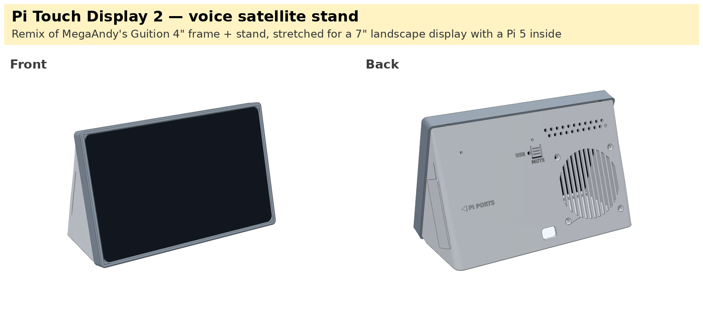
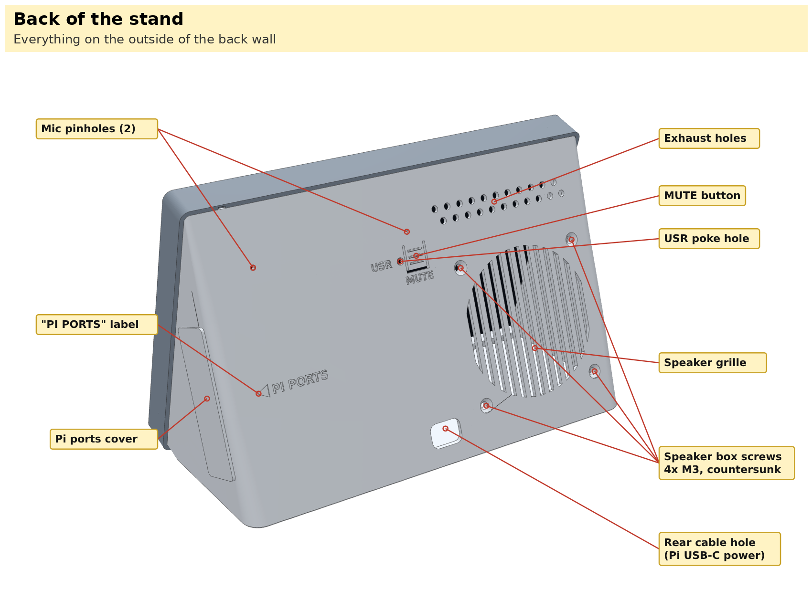
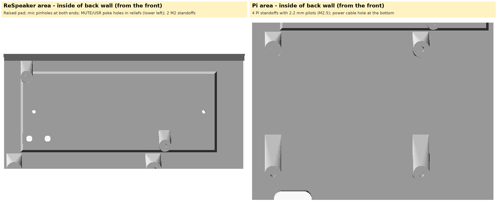
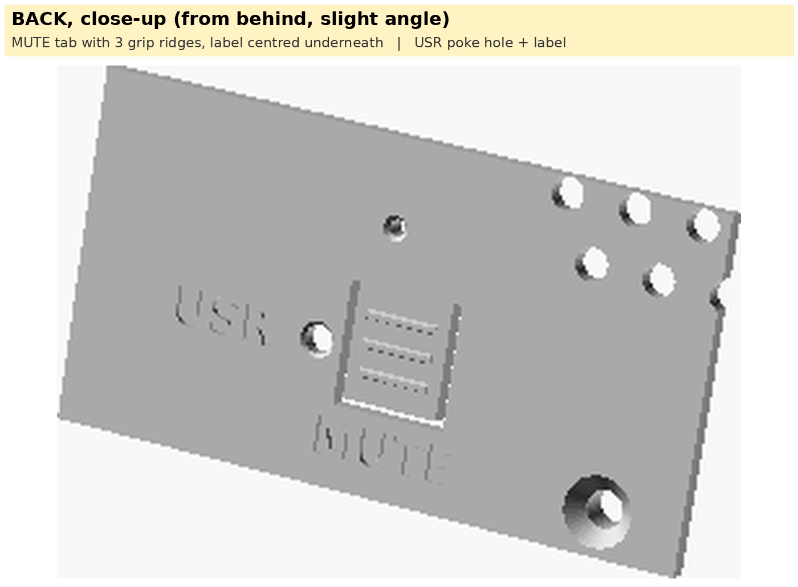
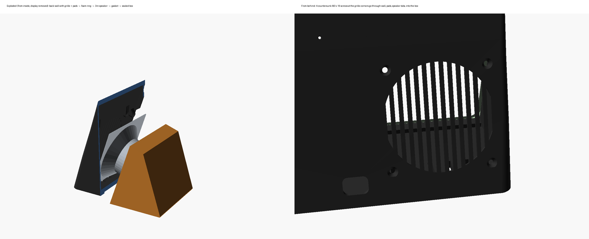
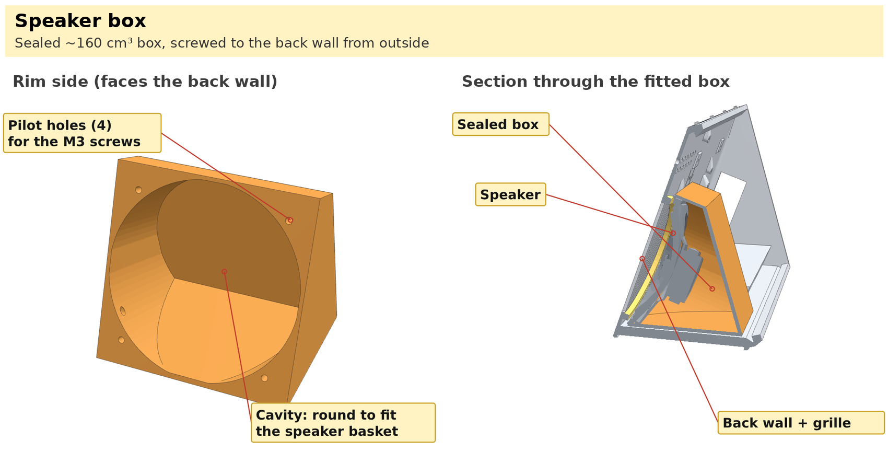
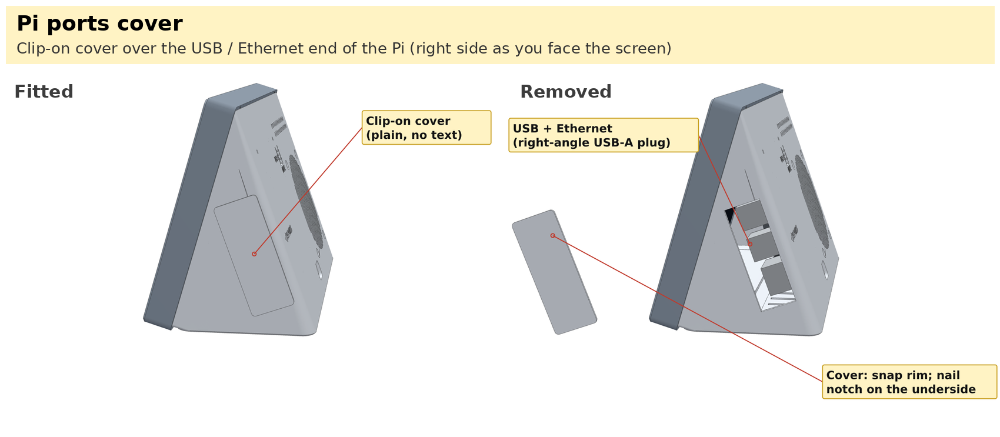

# Raspberry Pi Touch Display 2 — Voice Satellite Stand

A desk stand for the **Raspberry Pi Touch Display 2 (7", landscape)** that houses a **Raspberry Pi 5**, a **Seeed ReSpeaker Lite** (2-mic array) and a **3" speaker** in a sealed box. It turns the display into an always-on Home Assistant panel (e.g. a doorbell camera feed) and a voice-assistant satellite (Linux Voice Assistant with a custom wake word).

> **Remix notice.** This is a remix of **["Guition 4 inch Screen Frame and Stand (ESP32-S3-4848S040)" by MegaAndy](https://www.printables.com/model/1881011-guition-4-inch-screen-frame-and-stand-esp32-s3-4848s040)** on Printables. The frame band, wedge stand shape, snap tabs/grooves, rear cable hole, weighted base and foot recess all come from that design. The original STLs were stretched (not scaled) so every tested feature keeps its original size. This remix is shared under the same licence: **attribution required, non-commercial use only**.

## Print set (`stl/`)

| File | Print orientation | Notes |
|---|---|---|
| `stand.stl` | As exported: open front face down (same as the original) | ~190 × 123 mm footprint, 82 mm tall. Use a brim. No supports. |
| `frame.stl` | As exported: lip down | 194 × 125 × 16 mm. No supports. |
| `speaker-box.stl` | As exported: rim down | 80 × 80 × 60 mm. No supports (the inside must not have any). |
| `pi-ports-cover.stl` | As exported: plate down | 64 × 42 × 3.6 mm. No supports. |

Bed of at least 200 × 130 mm. PLA or PETG, 0.4 mm nozzle. Print the stand at high infill near the base if you want extra weight (as the original suggests).

## Hardware

| Part | Notes |
|---|---|
| Raspberry Pi Touch Display 2, 7" | 189.32 × 120.24 mm glass, 6.45 mm edge |
| Raspberry Pi 5 (2 GB is plenty) + Active Cooler (SC1148) | |
| 27 W USB-C power supply + USB-C cable with a **right-angle** Pi end | |
| Raspberry Pi 5 display cable, 22-way to 15-way, **300 mm** | the cable in the display box is meant for back-mounting the Pi |
| Seeed ReSpeaker Lite **USB** 2-Mic Array (no XIAO) | board revision v1.1 |
| Adafruit 3" speaker, 4 Ω 3 W | |
| JST-PH 2.0 mm 2-pin lead | speaker → ReSpeaker |
| Short USB-A → USB-C **data** cable, **right-angle on both ends** | Pi → ReSpeaker; the Pi's USB ports have 21 mm to the side cover |
| 4 × M2.5 × 6 self-tapping | Pi standoffs |
| 2 × M2 × 5 self-tapping | ReSpeaker standoffs |
| 4 × M3 × 16 countersunk self-tapping | from the back, through wall + speaker tabs into the speaker box |
| Foam tape: 2 mm (spacer ring), 1 mm (mic squares), 3 mm ring (speaker front), thin gasket (box rim) | |
| Optional: 1" × ½" steel flat bar, 3¾" long (~240 g) | weight pocket in the base |
| Optional: rubber feet, hot glue | |

## Features

- **Original look**: thin snap-on frame band and wedge stand, scaled up for a 7" landscape screen. Five snap tabs per long edge (three added, copied exactly from the original geometry).
- **Display clamp**: a spacer ring on the stand takes the 6.45 mm glass; 2 mm foam tape on the ring absorbs the ±0.5 mm tolerance. Frame corners match the glass's 8 mm radius.
- **Pi 5** on four printed standoffs on the back wall; USB-C power port sits right above the rear cable hole. Fit the microSD card before mounting.
- **Pi ports access**: clip-on cover on the right side (as you face the screen) over the USB / Ethernet end; lift it off with a fingernail at the notch under its lower front corner. See `images/pi-ports-cover.png`.
- **ReSpeaker Lite** on two M2 standoffs, mics sealed to two back-wall pinholes with small foam squares on raised pads.
- **MUTE** is a press-in flexure button printed into the back wall (with grip ridges); **USR** is a poke hole. Both engraved.
- **3" speaker** in its own sealed box (~160 cm³), clamped by four screws from the back; grille in the back wall.
- **Ventilation**: intake slots under the Pi, round exhaust holes along the top of the back wall.
- **Weight pocket** for a steel bar, loaded from inside before the display goes on.

## Assembly order

1. Flash the microSD and insert it into the Pi.
2. Speaker: solder the JST lead (leave a little slack inside the box, tack it with hot glue), 3 mm foam ring on the wall around the grille, speaker face-down on its pads, gasket on the box rim, box over the speaker, four M3 × 16 screws from the back. Seal the wire hole with hot glue.
3. ReSpeaker: foam squares on the two mic pads, pierce at the pinholes, board on its standoffs (mics to the wall), two M2 screws.
4. Pi: four M2.5 screws. Connect the ReSpeaker (USB), speaker (JST-PH), display ribbon (300 mm, fold the slack flat) and the display's GPIO power lead.
5. Weight bar into its pocket (dab of hot glue).
6. 2 mm foam tape on the spacer ring, display on the ring, frame snapped on (feed cables first).
7. Side cover on; rubber feet on the base.

## Check before printing

These were designed from published CAD / drawings and need a quick check against the real parts:

1. **Speaker tabs**: geometry is from Adafruit's CAD for the 8 Ω 1 W 3" speaker (same frame size as the 4 Ω 3 W). Confirm the four corner slots line up with a 60 mm square.
2. **ReSpeaker**: confirm the board is v1.1 and that the button marked MUTE is the one nearer the left end (the end without connectors). If not, swap `btn_label` in `source/td2-stand-additions.scad`.
3. **Glass edge thickness**: if it measures 6.45 mm, 1 mm foam on the ring is enough; otherwise use 2 mm.

## Software (brief)

- Home Assistant dashboard / camera feed in a full-screen browser (kiosk).
- **Linux Voice Assistant** (Open Home Foundation) as the Assist satellite; custom microWakeWord / openWakeWord models load from its wake-word folder.
- The Pi 5 has no hardware H.264 decoder — use a 720p sub-stream for the camera feed.

## Source (`source/`)

OpenSCAD + Python (trimesh / manifold3d) build scripts. `stretch.py` performs the feature-preserving stretch of the original STLs (download them from the original Printables page — they are not redistributed here). `td2-stand-additions.scad` holds the added features and their parameters; `compose.py` assembles the stand; `spkbox2.py`, `door.py`, `frame_corners.py` build the other parts; `check.py` / `check2.py` run the clearance checks. `render/` holds the three.js renderer used for the images in `images/`.

Dimensions were taken from: the Raspberry Pi Touch Display 2 product brief, Seeed's ReSpeaker Lite v1.1 STEP model, and Adafruit's CAD parts library. Those source files are not included.

## Licence

**CC BY-NC 4.0** — see `LICENSE`. Credit: original design by **MegaAndy**, ["Guition 4 inch Screen Frame and Stand (ESP32-S3-4848S040)"](https://www.printables.com/model/1881011-guition-4-inch-screen-frame-and-stand-esp32-s3-4848s040) on Printables.
